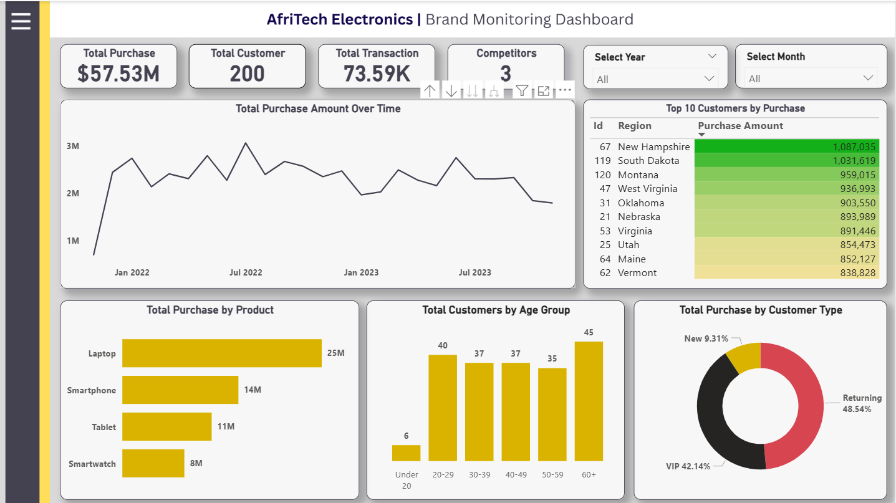
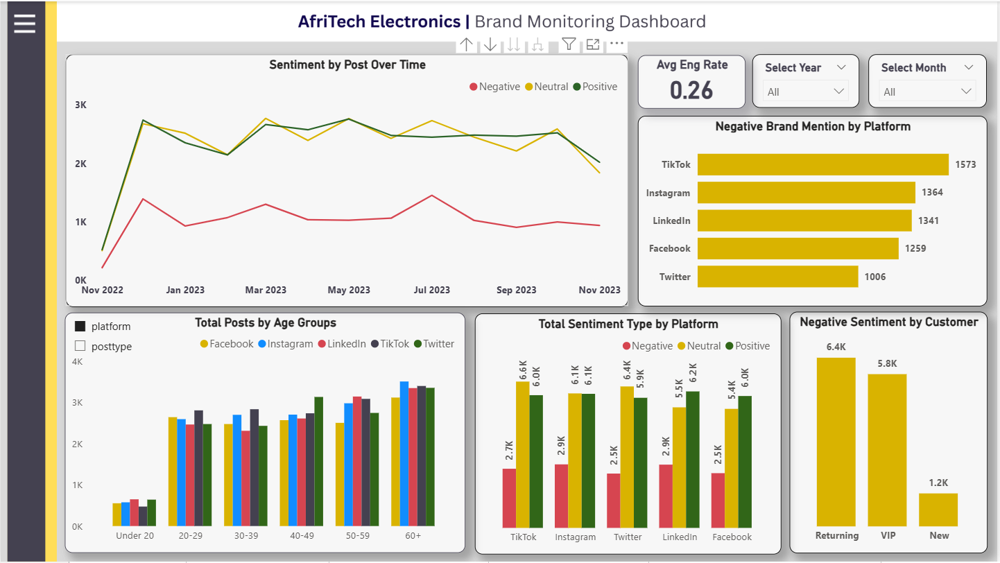
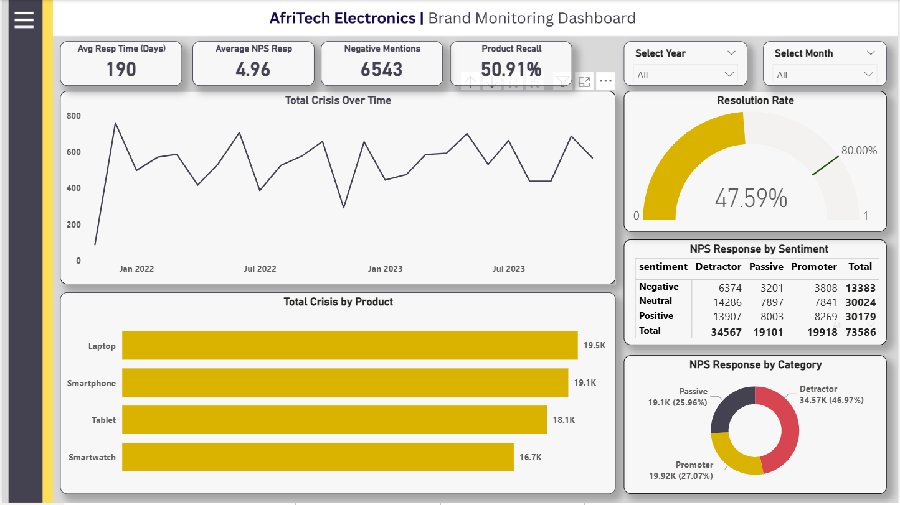

# AfriTech Electronics Brand Monitoring Analysis

## Project Overview

This project uses PostgreSQL and Power BI to explore customer purchases, social media sentiment and crisis response.

The dashboards bring these areas together to help identify reputational risks, compare product performance and highlight priorities for further investigation.

## Business Questions

- Which products and customer groups contribute most to purchases?
- How does sentiment vary across social media platforms?
- Where are negative brand mentions concentrated?
- How quickly are crisis events addressed?
- What proportion of recorded cases are resolved?

## Tools and Methods

- **PostgreSQL:** data preparation, relational table design, validation and exploratory analysis.
- **Power BI:** data modelling, interactive dashboards and KPI reporting.

Structured the source data into customer, transaction and social media tables linked through CustomerID. Used SQL joins, aggregations, common table expressions and reporting views to explore patterns.

Developed three dashboard pages with date filters and navigation between sales, sentiment and crisis management.

## Dashboard Previews

### Customer and Sales Analysis

Explores purchase trends, product performance, customer demographics and purchasing behaviour.

### Brand Sentiment and Social Media

Compares sentiment trends, negative brand mentions and activity across platforms and customer groups.

### Complaints and Crisis Management

Tracks response times, resolution rates, product recalls and customer feedback.

### Report Navigation

Provides navigation between the analytical pages.

## Selected Dashboard Observations

| Measure | Displayed result |
|---|---:|
| Customers | 200 |
| Transaction records | Approximately 73,590 |
| Returning customers' share of purchase amount | 48.54% |
| Negative brand mentions on TikTok | 1,573 |
| Average response time | Approximately 190 days |
| Resolution rate | 47.59% |

Laptops have the largest displayed purchase total. TikTok has the highest count of negative brand mentions among the platforms shown.

The response-time and resolution indicators highlight areas for investigation into case handling and service performance.

## Recommendations

- Validate response-time calculations and event dates, then agree service targets and escalation rules.
- Review unresolved cases to identify recurring issues.
- Compare product complaints and recalls against purchase volumes.
- Investigate negative brand mentions alongside each platform's total activity.
- Measure whether subsequent actions improve response times, resolution rates and customer feedback.

## Interpretation Notes

- Results describe the current dashboard and do not establish the causes of observed patterns.
- Multiple transaction and social media records can relate to one customer. Cross-table analysis requires checks to prevent duplicated totals.
- The dashboard's average NPS response is an average survey rating, rather than the standard Net Promoter Score.
- Screenshots show historical reporting snapshots.
- Recommendations are proposed actions rather than measured business improvements.

## Public Portfolio Contents

This repository contains a project summary and dashboard screenshots. Source datasets, the Power BI workbook and supporting working documents are not included.

## Author

Ayodeji Sonde
